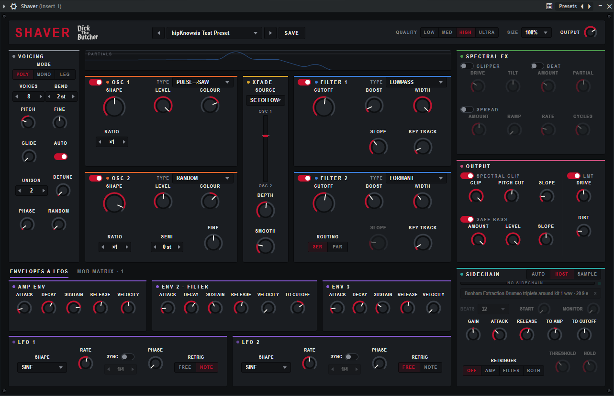

# Shaver #

## Downloads, add-ons (and info about) the Shaver additive synth. Source code is not in this repo ##

What is Shaver? An additve synth VST with a unique twist. Shaver is very much like the NI synth "Razor," but is not a clone of it. The twist is that Shaver gives you the ability to load samples to use as sidechain input and modulate the oscillators' amplitude, filter, or both.
One shot samples can be used, Shaver will loop or retrigger them automatically. Long audio clips up to 30s can be used, allowing for continually varying modulation of the synth during a verse or section of your song. If you don't want to use the sidechain feature, you don't have to use it--that's fine because you still have a cool additive synth with automatable controls, voice quality control to manage CPU utilization, and so forth. It's a nice synth even without the amazing sidechain feature.
If you've used Razor you will pick up how to shape sounds with Shaver right away.
